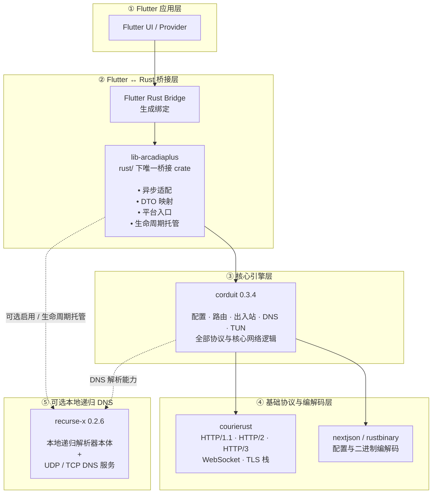

# ArcadiaPlus

<p align="center">
  
</p>

<p align="center">
  Flutter + Rust 跨平台互联网代理客户端<br>
  <a href="README_EN.md">English</a>
</p>

## 这是什么

ArcadiaPlus 是一个跨平台的代理客户端：Flutter 负责界面与各平台接管，Rust 侧只保留一层 FFI，代理引擎、DNS、TUN 数据面与协议实现全部来自 [corduit](https://crates.io/crates/corduit)。

### Android 后台运行与故障核对

VPN 由前台服务持有，界面退到后台或从最近任务中划掉不会主动停止隧道。活动隧道持有部分唤醒锁，停止时释放。系统重建服务时，从应用私有的 `noBackupFilesDir` 恢复配置、手动选择的节点、路由模式和本地递归 DNS，再启动数据包处理。若系统没有及时重建服务，重新打开应用也会尝试恢复；主动断开和撤销 VPN 权限会先禁用恢复。恢复文件含连接配置，不进入系统备份，也不写入日志。

这不等于绕过系统电源管理：强行停止应用、撤销 VPN 权限和厂商省电限制仍由系统决定。锁屏验收应同时确认通知、实际请求和重新打开应用后的状态，不能只看 VPN 图标。Android 对休眠期间网络和唤醒锁的限制见[官方说明](https://developer.android.com/training/monitoring-device-state/doze-standby)。

`Interrupted system call` 表示系统调用被信号打断，转发层应重试并检查取消状态。`no salt received` 仅说明对端未返回 Shadowsocks 响应，不能单凭它认定密码错误或 DNS 故障；应核对实际节点的 cipher、plugin、DNS 上游及同节点的其他客户端结果。`NXDOMAIN` 必须保留其语义，不能伪造 IP 或悄悄改走系统 DNS。公开域名的在线核对可运行 `cargo test --manifest-path rust/Cargo.toml --test dns_app_contract incident_domain -- --ignored --nocapture`，该测试经过应用实际使用的解析器，普通离线测试不会访问公共 DNS。

TUN 收包线程不等待上游 DNS：查询交给 4 个工作线程和最多 64 个待处理数据包的队列。慢查询不会挡住 TCP 握手和确认包，队列满时按 UDP 语义丢包等待客户端重试，停止时丢弃排队任务。

2026-11-12 的 Android 17 蜂窝网络实测中，本机递归对 `jpushsc.m.jd.com` 的 20 次查询返回 13 次 NXDOMAIN、7 次 SERVFAIL；同机 AliDNS DoH 对照 20 次成功。随后锁屏测试发现，仅开启“优先加密 DNS”仍会遇到原 DoT 上游超时。因此测试手机关闭本机递归，并将通用 DNS 覆盖为 `https://223.5.5.5/dns-query`、`https://223.6.6.6/dns-query`，保留订阅中的专用解析规则。代码修复和上游配置调整分别验收；本机递归在该网络上的失败仍未解决，不能通过忽略 NXDOMAIN 来掩盖。

连接 ADB、在手机启动 VPN 后，可运行 `python scripts/verify_android_device.py --rounds 2`。脚本构建独立诊断 APK，确认普通应用 UID 接入 ArcadiaPlus 的 VPN，再查询五个域名并校验 GitHub、Google 和百度的 HTTPS 返回码及完整响应。诊断时显示临时页面并运行前台服务，结束后关闭。TLS 证书校验保持开启，任一检查失败或测试超时时命令返回非零，并保留已完成的结果；报告默认写入 `.build/android-validation/report.json`。多设备时使用 `--serial`，SDK 不在标准位置时使用 `--sdk`。该命令不读取订阅、不更改代理配置；新安装的诊断包默认在结束时移除，已有诊断包保留。

`--delay 300` 可留出五分钟锁屏观察时间。部分厂商仍会冻结独立诊断进程，必须分别记录诊断进程与 VPN 服务的状态：测试进程停止执行不等于 VPN 断开，ADB root 请求成功也不等于普通应用联网成功。脚本不会关闭系统冻结机制。

本轮链路修复覆盖两个实际故障。加密 DNS 使用的 TLS 客户端曾漏报 TLS 1.2、反向判断降级标记，并缺少已声明的 X25519 交换路径；Courierust 修复后通过 OpenSSL 的 TLS 1.2/1.3 证书校验互操作测试。TUN 下载端曾在数据尚未确认时丢弃副本，忽略接收窗口，导致大响应或应用暂停后永久缺字节；Corduit 现在保留有界发送队列、重传未确认数据、探测零窗口，并等待数据确认后发送 FIN。回归测试覆盖丢包、序列号回绕、零窗口恢复和双向半关闭。

DNS 转发还曾把单次交换的 1.5 秒误作整组上游的期限，再由多个服务器平分。现在转发组使用原有查询总预算（常规查询 5 秒、引导查询 3 秒），仍在同一截止时间内完成；延迟应答测试验证了旧代码的过早超时。该修复不改变上游、专用域名规则或证书校验。

当前联调使用 `D:\RustProject\Corduit` 的 0.3.8 本地源码和已发布的 Courierust 1.1.3。引擎源码没有复制到应用项目。正式发布前需确认已发布的 Corduit 包含当前修改，再恢复注册表依赖并更新锁文件；本地路径依赖不会通过发布依赖检查。

### 内存边界

平台 TUN 写出队列同时限制为 512 个排队包和 1 MiB 自有包数据；正在写入的包仍计入字节预算。队列不保留输入切片背后的大缓冲区，满队列时按网络拥塞语义丢包，断开接收端则明确报错。TCP 的未确认数据仍由发送队列保留并重传。这个预算不包括其他连接缓冲、线程栈、TLS 状态或整个进程的 RSS。

Flutter 的配置去重只保留 SHA-256 摘要；HarmonyOS 因扩展进程和回滚需要保留正文。Android 恢复文件将字符串按不超过 4 KiB 的 UTF-8 片段编码，以 8 KiB 文件缓冲写入，避免序列化器再次分配完整配置字符串。按编码后大小执行 32 MiB 上限，失败时保留旧文件。原生恢复状态仍保留重启所需配置，不能为了减小数字而破坏 VPN 模式切换。隐藏 DNS 面板释放 Dart 侧记录副本，原生 DNS 缓存继续为代理服务。

内存验收需在同一设备、配置和负载下比较 PSS/RSS、连接峰值以及流量结束后的回落。调试包不能直接与发布包比较，也不能把队列字节上限当成进程内存降幅。

它读 Clash 形态的配置（`proxies`、`proxy-groups`、`rules`、`rule-providers`、`dns`），把配置翻译成引擎执行的规则表，并把执行情况显示出来：规则表本身、每条规则的命中次数、转换时丢了什么、规则集上次刷新是什么时候。它不提供服务器、节点或订阅——配置由你准备，合法性由你负责。

下面把当前版本的实际能力写清楚了，包括哪些平台还不能宣称可用。

<br>

### 📸 产品截图
<details open>
<summary><b>💻 Windows 电脑端 </b></summary>
<br>
<div align="center">
  
  
  <br><br>
  
  
</div>
</details>
<br>
<details open>
<summary><b>📱 安卓端 </b></summary>
<br>
<div align="center">

&nbsp;&nbsp;&nbsp;&nbsp;

</div>
</details>

## 当前实现

- Flutter Material Design 3 UI：明暗主题、动态颜色、Google Fonts、响应式导航和页面/组件动画。
- Rust 侧只留一层 FFI：代理引擎、DNS、TUN 数据路径与全部代理协议都由 [corduit](https://crates.io/crates/corduit) 提供，本仓库不再重复实现协议；桥接层负责同步/异步适配、DTO 映射与平台入口。
- 运行配置使用严格校验：必要规则集缺失、规则类型不受支持或出口不存在时拒绝启动，不通过跳过规则改变实际分流。离线预览可展示转换警告。
- 可选本地递归解析：开启后由 [RecurseX](https://crates.io/crates/recurse-x) 从根服务器迭代解析，corduit 的 DNS 上游指向该前端。
- 规则集（`rule-providers`）由 Dart 侧托管：`RuleProviderService` 下载、校验、规范化并缓存到应用私有目录，按 profile 声明的 `interval`（默认 86400 秒）自动刷新；交给引擎的是本地 `file` 规则集。下载失败、空内容或存在不支持的条目时保留上一份完整缓存；必要规则集没有有效缓存时拒绝启动，不跳过规则改变分流。
- GeoIP 数据库随安装包分发（`assets/Country.mmdb`），启动时解包到应用支持目录并注册给引擎；解包或注册失败会记录原因，此时 `GEOIP` 规则不会被匹配——不静默降级。
- Android、Windows、Linux 共用 Rust TUN 数据包处理器，各平台独立管理设备生命周期。
- Windows、macOS、Linux、Android、iOS、HarmonyOS NEXT 的应用图标均由 `assets/arcadiaplus.png` 统一生成。

## 启动诊断与界面行为

启动失败先看首页保留的错误详情。配置转换和 VPN 建立的原始错误会写入日志；清理动作不会再把原因替换成“没有可用配置”。只有引擎确认运行、Android VPN 数据面建立成功后，首页才显示运行中。

新安装及没有保存加密选项的旧配置默认遵循订阅 DNS；已经保存的严格加密选项保持不变。配置没有 DNS 上游时，应用仍使用内置的加密地址。“优先加密 DNS”将已知公共解析器升级到同一服务商的验证端点，同时保留订阅的私有和未支持地址，因此可能仍有明文查询，也可与本机递归共用。“禁止明文 DNS（严格）”是单独的约束，覆盖主解析器、备用解析器、引导解析器和域名策略，启用前检查兼容性；检查不通过则保留原模式。DNS 设置页使用运行时转换器检查当前配置，并提供启动／重启应用按钮。

已知公共解析器只升级到同一服务商的证书验证端点。例如 `119.29.29.29` 使用 DNSPod 的 DoT 服务，以 `dot.pub` 验证证书；服务身份见 [腾讯云接入文档](https://cloud.tencent.com/document/product/302/110784)。订阅若依赖 `tcp://私有解析器:8080`，严格加密模式仍会拒绝启动。此时需要订阅方提供加密端点，或由用户关闭保护以保留订阅解析规则。关闭保护可能使用明文 DNS，不会关闭 TLS 证书校验，也不会把私有解析规则替换成公共 DNS。

本机递归随代理启动、停止，仅监听回环地址。UDP 与 TCP 都绑定成功才发布地址，不再以两个固定网站是否可达决定销毁服务。转发层保留本地优先、失败恢复预算和短暂冷却机制；网络限制导致递归失败时，仍由订阅上游接替。DNS 页分别显示设置、监听状态和实际查询计数：监听就绪不等于解析成功，递归也不等于传输加密。启动异常同时进入日志与状态卡。

VPN 的 DNS 应答区分 NODATA、NXDOMAIN 与查询失败：域名存在但没有 AAAA 记录时返回 NOERROR 空答，域名不存在时返回 NXDOMAIN，超时等故障才返回 SERVFAIL。Corduit 的适配层保留这个类型信息，不再把正常空答记录成解析错误，也不因空答绕过订阅策略查询系统 DNS。

节点页的“自动”按可用宽度决定列数，“一列 / 两列”严格采用用户选择；窄卡片将名称移到图标下方，并随文字缩放增加高度。手机导航悬浮于完整页面之上，仅对底栏范围做背景模糊；列表末尾与浮动按钮使用同一份导航避让尺寸。列表入场复用页面时间线，不为每行分配动画控制器或延迟计时器；应用后台状态与系统减少动态效果设置仍由全局动效开关控制。渲染耗时需要在目标设备的 profile 模式下测量，不能用动画测试通过代替性能数据。

Material Shape 变形集中在 `ExpressiveShape` 与 `AnimatedExpressiveShape`：前者复用页面时间线，后者用于状态切换，首次变化时才创建控制器。首页状态、空状态、节点选中标记和 DNS 状态使用同一套缓存形状与弹簧参数。连续操作从当前进度和速度继续，动画只更新裁剪区域；静止状态不循环播放。

## 首页缓存、资源管理与配色

出口 IP 检测由应用级控制器持有。页面切换保留结果和正在进行的请求；同一路由一小时内不会因返回首页重复请求，失败结果也适用。实际节点选择变化、代理端口或路由模式变化使缓存失效，手动刷新始终可用。重复同步同一个节点不会触发失效。进入后台会取消未完成请求并拒绝迟到结果，恢复前台后可重试未完成的查询；已完成的缓存继续有效。首页已移除 DNS 查询区，诊断记录仍在连接页的 DNS 标签中。

冷启动只加载设置和原生库；启动服务、访问代理页或查看规则时才构建引擎。配置列表只存元数据，YAML 由配置文件持有；旧版本偏好设置中的 YAML 副本在确认磁盘文件可用后移除，缺失文件先从副本恢复。代理页只保留节点和分组，不保留另一份 DNS 与规则表；订阅内容未变时复用解析结果。页面销毁时释放连接快照，滚动位置使用最多 12 个页面的 LRU 状态缓存，节点搜索和布局选择独立保存。图片缓存上限为移动端 16 MiB、桌面端 32 MiB，应用进入后台时回收未使用的解码图片；替换壁纸会清除该文件的各尺寸缓存。

文件维护在启动和恢复前台时执行，每天最多一次：清理超过 24 小时的规则下载临时文件和未选中的旧壁纸，不删除正在使用的规则或当前壁纸。动效沿用 Flutter 帧调度器与原生导航时间线；页面、MD3E 形状和首屏列表共享进度，推入页面不再创建第二个入场控制器。系统减少动态效果设置与后台暂停始终生效。实现依据 [Material 3 动效规范](https://m3.material.io/styles/motion/overview/how-it-works)。

十组预设以用户提供的《潘通 PANTON 3.0 版本色卡 C》PDF 为参考，通过 MuPDF 1.28.2 渲染为 sRGB 后采样，并由 `ColorScheme.fromSeed` 生成 MD3 明暗角色色。PDF 本身使用 CMYK 印刷模拟，因此下表是屏幕近似值，并非 Pantone 官方 RGB 定义或印刷校色保证。主题选择器保留参考色号；动态取色仍使用系统提供的配色。

| 预设 ID | 色号 | 屏幕种子色 | PDF 页码 |
| --- | --- | --- | --- |
| default | 286 C | `#0060A9` | 6 |
| ocean | 3005 C | `#0081C4` | 7 |
| forest | 347 C | `#009A66` | 8 |
| sunset | 179 C | `#F15C2A` | 3 |
| purple | 2587 C | `#6351A2` | 5 |
| teal | 320 C | `#00A1B2` | 7 |
| rose | 213 C | `#EC0B6D` | 4 |
| amber | 123 C | `#FDB826` | 1 |
| indigo | 2756 C | `#173B8D` | 6 |
| cyan | 3125 C | `#00B5C8` | 7 |

首页出口评级、流量说明和主题名称覆盖全部 11 种语言，简繁中文分别维护。回归测试检查一小时缓存边界、真实 TCP/UDP 出口计数、缓存清理边界、明暗文字对比度与页面布局。内存缓存上限不是进程内存承诺；实际 PSS/RSS 与帧耗时需用相同设备、相同配置的 profile/release 构建比较，可运行 `scripts/android-profile.ps1` 采样，方法见 [Flutter 内存分析](https://docs.flutter.dev/tools/devtools/memory)。

## 规则

规则表由配置转换逐条翻译给引擎，支持的类型与语义：

| 类型 | 语义 |
| --- | --- |
| `DOMAIN` / `DOMAIN-SUFFIX` / `DOMAIN-KEYWORD` / `DOMAIN-REGEX` | 域名匹配；正则原样交给引擎编译，`(?-i)` 之类内联标志按 Clash 语义生效 |
| `GEOIP` | 国家码匹配；`LAN` / `PRIVATE` 不需要数据库，其余需要 `Country.mmdb`（随包分发，缺失时记录原因，规则不会命中） |
| `IP-CIDR` / `IP-CIDR6` / `SRC-IP-CIDR` | 地址段匹配；`no-resolve` 原样透传，带该标志的规则只看客户端给的地址，不触发解析 |
| `DST-PORT` / `SRC-PORT` / `IN-PORT` | 端口与端口区间（`80,443,1000-2000`） |
| `IN-TYPE` / `IN-NAME` / `IN-USER` | 连接从哪个 inbound 进来、用什么协议、以哪个用户通过认证（比较时忽略大小写） |
| `PROCESS-NAME` / `PROCESS-PATH` | 进程匹配 |
| `NETWORK` | `tcp` / `udp` |
| `RULE-SET` | 引用 `rule-providers`；引擎只读本地文件，下载、校验、缓存与刷新都在 Dart 侧完成 |
| `GEOSITE` | 按同名 provider 匹配；`cn`、`geolocation-!cn`、`category-ads-all`、`private` 可补齐对应的 Loyalsoldier 数据，其余类别需提供兼容规则集 |
| `AND` / `OR` / `NOT` | 逻辑组合，支持括号嵌套，如 `AND,((DOMAIN-SUFFIX,a.com),(NETWORK,tcp)),PROXY` |
| `MATCH` / `FINAL` | 兜底规则 |

运行配置遇到不支持的规则（例如 `SCRIPT`、`PROCESS-PATH-REGEX`、`SUB-RULE`）会给出错误并停止加载；不支持的二进制规则集也不会被当作文本装载。更新下载失败时保留最近一次有效缓存，没有有效缓存的必要规则集必须先补齐。

设置页的「规则」入口（`/rules`）显示引擎里的规则表与每条规则的**实时命中次数**、本次转换的全部警告，以及每个规则集的就绪状态、条目数与上次刷新时间。命中次数是这套界面存在的理由：一条从未命中、或命中了一切的规则，可以直接看出来。表是一页一页读的：Rust 侧保留快照、按窗口与搜索返回（顶部每 5 秒静默刷新一次命中数），界面只构建可见行——一份内联了 ACL 的订阅可能有几万条规则，整表一次性送进 UI isolate 再逐行建组件，正是这个诊断页把整个应用拖垮的原因。搜索框在 Rust 侧扫描全表，返回命中总数与前 500 条命中。

## 协议状态

当前构建使用 crates.io 发布的 Corduit 0.3.5 与 RecurseX 0.2.6，`rust/Cargo.lock` 固定包版本和校验和。本构建启用 `hysteria`、`hysteria2`、`tuic`、`reality`、`shadowtls`、`wireguard`、`quic`、`tls13` 等功能。CI 检查应用与引擎共享同一个解析器、套接字工厂及 Android JNI 依赖。

| 协议 | 实现来源 | 说明 |
| --- | --- | --- |
| HTTP / SOCKS5 | corduit | 出入站路径均在引擎内 |
| Shadowsocks | corduit | 含 AEAD 与流密码路径；SIP003 插件 `obfs`（simple-obfs http/tls）、`v2ray-plugin`（websocket + mux 帧化，默认开——与参考服务端/mihomo 一致，`mux: false` 关闭；`skip-cert-verify` 与自定义 `headers` 均透传）与 `shadow-tls`（v3）均为原生实现，带插件的节点照常转换（未实现的插件与选项按名字拒绝）；插件只塑形 TCP，因此带插件的节点自动关闭 UDP |
| ShadowsocksR | corduit | 流密码 + protocol/obfs 插件层；`auth_chain_*`、`random_head`、AEAD 方法与异域块密码明确拒绝并给出原因 |
| VMess / VLESS / Trojan | corduit | 含 WebSocket、gRPC、TLS 传输 |
| Hysteria 1 / Hysteria 2 / TUIC | corduit（`hysteria`、`hysteria2`、`tuic` feature） | QUIC 路径，本构建全部启用 |
| Snell | corduit | v4/v5 记录协议；`obfs: http` 与 `obfs: tls` 均按参考实现（TLS 混淆的 ClientHello 与记录分帧逐字节对齐 sing-snell / Surge 6.4.4），v6 与 v4 以下按名字拒绝 |
| WireGuard | corduit（`wireguard` feature） | 隧道路径，本构建启用 |
| ShadowTLS | corduit（`shadowtls` feature） | v3 隧道：手写引擎配置可用 `type: shadowtls`，订阅侧的 `plugin: shadow-tls` 同样可用——插件路径复用同一套握手与帧实现 |
| shadowquic / `ssh` 类 | 不支持 | 桥接层在配置转换时丢弃该节点并回落引用，同时上报警告 |

协议进入“已支持”状态至少需要：官方/主流服务端互操作测试、TCP 与 UDP 测试、认证失败测试、断线重连测试，以及各目标平台上的集成测试。

## 平台状态

| 平台 | UI 壳 | 系统代理 | 全局 TUN/VPN | 当前结论 |
| --- | --- | --- | --- | --- |
| Android | 有 | 不适用 | `VpnService` 路径已实现 | 需要真机、ABI 和长连接回归测试 |
| Windows | 有 | 已实现 | Wintun 路径已实现 | 需要管理员权限和 Windows 10/11 实机测试 |
| Linux | 有 | GNOME 设置路径（逐条校验 `gsettings` 退出码） | corduit 提供 IPv4 TUN 路径 | TUN 当前仅允许 global，rule/direct 会明确拒绝；仍需 root/实机验证 |
| macOS | 有 | `networksetup` 路径 | 未实现 Network Extension | 不能宣称全局代理支持 |
| iOS | 有 | 不适用 | 未实现 Packet Tunnel Extension | 仅应用壳 |
| HarmonyOS NEXT | 有 | 不适用 | `VpnExtensionAbility` 隧道 + 引擎数据面已实现 | 需要 HarmonyOS NEXT 真机验证（授权弹窗、隧道与引擎分流），未经真机不得宣称可用 |

## 路由模式

全局模式使用代理页的 `GLOBAL` 选择组，选择按配置独立保存。订阅未定义该组时，应用用可用节点生成，不把排在首位的国内直连组当作全局出口；无可用节点时拒绝流量。订阅显式定义的 `GLOBAL` 保留其成员和选择，包括用户自行配置的 `DIRECT`。

RecurseX 0.2.6 的 DoH、DoH3 适配器当前要求连接 IP 与证书 IP 身份一致，不支持独立的域名身份覆盖；升级 Courierust 不会改变这层适配约束。默认使用支持 IP 证书的阿里 DoH 地址。已知公共 DNS 的旧写法转换为同一服务商的兼容加密端点，并记录转换警告；未知私有 DoH 配置会明确报错，需使用该服务商支持的 IP 端点或 DoT/DoQ，不能通过关闭证书校验绕过。

`rule` / `global` / `direct` 的判定全部在引擎里完成：inbound、TUN 数据面与 Android VPN 都把连接交给同一个路由器，所以切换模式从不需要重建隧道。

| 平台 | 切换模式时做什么 | 说明 |
| --- | --- | --- |
| Android | `set_android_proxy_mode`（引擎运行时模式）+ 通知文案 | VPN 路由固定 `0.0.0.0/0`，模式由引擎在拨号时决定；进隧道的 53 端口查询统一由 netstack 的 fake-IP 解析器应答 |
| Windows | `set_windows_proxy_mode` | TUN 保持捕获，模式仅改变引擎分流；切换不再重建路由 |
| Linux / macOS | `set_proxy_mode`（引擎运行时模式） | Linux TUN 开启时仅允许 global；macOS 尚无 TUN 实现，系统代理仍支持引擎分流 |
| 系统代理 | 与模式无关 | 指向本地 mixed 端口；Linux 逐条校验 `gsettings` 退出码，Windows 启用前会快照原代理设置并在关闭时恢复 |

规则集在构建引擎、profile 更新时检查；服务运行期间恢复前台或每隔 15 分钟进行到期检查。仅打开已停止服务的首页不会构建引擎或下载规则集。支持手动强制更新；常规检查只请求已经到期的规则集，并使用 ETag / Last-Modified 条件请求。下载失败保留上次有效内容；下载成功后重新加载引擎。HarmonyOS 当前通过重启 VPN 扩展更新配置，会中断已有连接。尚未实现系统后台定时更新任务。

### 策略组语义

profile 里的 `proxy-groups` 是嵌套结构：一个 `select` 组的成员既可以是节点，也可以是另一个组，转发时引擎沿这条链逐层下钻（深度上限 10）。由此有两条必须知道的结论：

- **只有被规则引用的组才会决定出口。** 一个组如果没有任何规则指向它、也没有被别的组引用，改变它的选中项不会影响任何流量。典型机场配置会定义十几个组（流媒体、Steam、Cloudflare 等），其中绝大多数只服务特定规则。
- **组的默认成员是成员列表的第一个。** 在用户做出选择之前，引擎按 Clash 语义使用首成员，因此“首次连接走到了列表第一个节点”是配置的默认行为，不是选择丢失。应用把每个组的选择持久化，并在引擎就绪后重新下发全部组，切换 profile 时同样重新下发。

排查「出口与预期不符」时按此顺序确认：目标流量被哪条规则匹配 → 该规则的组 → 该组的选中成员 → 该成员是不是节点（也可能是嵌套组）。应用在每次下发选择后都会向引擎读回实际生效的成员，不一致时记录 `Selection mismatch` 并重试。

## 空闲开销

代理客户端绝大多数时间没有数据要传，因此空闲连接的代价直接决定设备功耗与整机响应。本项目对此有两条硬约束，均已落到代码并覆盖测试：

- **读操作不会在没有拿到数据的情况下反复重入。** 引擎的空闲等待建立在 `Notify` 闩锁上，而闩锁语义只回答“是否观察到通知”，无法区分“闩锁唤醒（根本没有阻塞）”与“超时”。`read_blocking` 因此使用 `wait_latched`，仅在“闩锁唤醒且接收缓冲仍为空”时退避 1 ms；携带数据的唤醒立即返回，超时路径不受影响。
- **没有数据就不占用唤醒。** `push_recv_data` 在接收缓冲已满、或载荷为空（纯 ACK、零窗口探测）时直接返回，不再置位唤醒闩锁；`close` 只在 open→closed 翻转时通知一次。

与之配套的是线程所有权：`relay_with` 在每一条出口路径上 join 自己启动的两个方向线程，且某一方向 panic 时先释放两侧再 join，因此它返回之后不会再留下持有传输与 socket 的活动线程。

- **错误码要按契约选，不能按语意描述选。** `std::io::Write::write_all` 对 `ErrorKind::Interrupted` 是**无限重试**（约定为“被信号打断，内容无问题”）。把“会话已取消”映射成 `Interrupted`，会让每一次帧写入失败都变成“分配一个错误字符串 → 立即重试 → 再失败”的死循环：循环体内没有任何系统调用可以阻塞，因此线程满核运行且 `wchan` 为空。取消现在映射到 `ConnectionAborted`（终态）。

上述三条在真机隧道开启状态下测得的前后对比（同一设备、同一订阅、同一时间窗口口径）：

| 观测量 | 修复前 | 修复后 |
| --- | --- | --- |
| 进程 `utime`（每 10 s） | 7.00 核 | **0.01 核** |
| 进程 `stime` | 0.05 核 | 0.01 核 |
| `procs_running` | 118 | **1** |
| `PSI cpu some avg10` | 78.58% | **5.68%** |
| `corduit-relay-up` / `-down` 线程数 | 136 / 41 | **8 / 8** |
| 处于运行态且 `wchan` 为空的线程 | 117 | **0** |
| 代理是否仍可用 | 是（出口 HK） | 是（出口 HK） |

### 在真机上验证

空转的特征是**用户态 CPU 高、系统调用近乎为零、I/O 不增长**三者同时出现。以下命令不需要 root：

```bash
# 1) 系统级 CPU 停顿（Pressure Stall Information）：持续偏高说明有进程在抢 CPU
adb shell cat /proc/pressure/cpu

# 2) 就绪队列长度：持续偏高就是用户感受到的“卡”
adb shell grep procs_running /proc/stat

# 3) 进程用户态/内核态时间，两次采样求差（单位：100 Hz 计时脉冲）
adb shell 'P=$(pidof com.blueokanna.arcadiaplus); awk "{print \$14, \$15}" /proc/$P/stat; sleep 15; awk "{print \$14, \$15}" /proc/$P/stat'

# 4) I/O 增量：与 3) 对照，若 CPU 增长而字节数不增长，即为空转
adb shell cat /proc/$(pidof com.blueokanna.arcadiaplus)/io

# 5) 线程级定位：wchan 为空（显示为 0）表示线程停留在用户态，未阻塞在任何系统调用上
adb shell 'P=$(pidof com.blueokanna.arcadiaplus); for t in /proc/$P/task/*; do echo "$(cat $t/comm) $(cat $t/wchan)"; done | sort | uniq -c | sort -rn'
```

判据：空闲隧道下 `procs_running` 应为个位数，运行中线程的 `wchan` 应为内核睡眠符号而非空。

## 已知限制

这些是需要知道的边界，避免把某个设置当成它并不具备的能力：

- App 能编辑的 DNS 面是 DNS 设置页，且只在“覆盖 DNS”开启时生效——未开启时以 profile 的 `dns` 段为准。覆盖时也不是整段替换：`nameserver-policy` 与 `default-nameserver` 仍从 profile 读取（前者是订阅自家节点域名的唯一解析途径，后者是形如 `tls://doh.pub` 这类按域名书写的上游的引导），设置页新增的**引导解析器**列表排在 profile 的条目之前。引擎更宽的 DNS 面（`fallback-filter`、`fake-ip-range` / `-filter` / `-ttl`、`cache-size`、`hosts`）仍由 profile 直接透传。
- 系统代理的 bypass 列表会下发至 Windows（WinINET）、Linux（`ignore-hosts`）和 macOS（`networksetup`）；不支持 CIDR 的平台会收到等价的精确通配模式。

## 系统代理与 DNS 连接行为

Windows 默认在服务启动后启用系统代理（可在设置中关闭自动启用），并写入绕过列表。新安装和旧设置迁移均覆盖以下地址，同时保留已有的自定义条目、IPv6 回环和链路本地条目：

```text
localhost;127.*;192.168.*;10.*;172.16.*;172.17.*;172.18.*;172.19.*;172.20.*;172.21.*;172.22.*;172.23.*;172.24.*;172.25.*;172.26.*;172.27.*;172.28.*;172.29.*;172.30.*;172.31.*;*.local
```

Windows 通过 WinINET 连接 API 保存原设置、写入并读回确认，停用时恢复。读取使用 `INTERNET_PER_CONN_FLAGS_UI` 保留用户配置的自动检测状态；未启用的 PAC 地址即使被系统保留，也不再导致启用失败后回滚。读回失败仍会恢复原设置。此绕过列表影响系统代理；TUN/VPN 的流量由隧道路由和引擎规则决定。

- **优先加密 DNS**：将支持的公共解析器升级到同一运营方的加密端点，校验证书；保留订阅中的私有解析、域名策略和引导解析。不能据此宣称所有 DNS 都已加密。
- **严格加密 DNS**：要求每条解析路径满足加密条件，不兼容的配置在启动前报错；关闭本机递归，不因 TLS 失败偷偷降级为明文。
- **本机递归解析**：仅监听回环地址，健康时优先使用；失败由已配置的上游接替。根与权威查询需要 UDP/TCP 53 可达，监听就绪不等于所有域名均可解析，也不等于已启用 DNSSEC 信任链验证。
- **Android DNS**：VPN 内的 DNS 由 netstack 应答。应用不会额外尝试绑定需要权限的低端口；显式配置的非特权监听端口仍可使用，递归服务继续使用独立的回环临时端口。

Shadowsocks 接收器保存盐、加密长度和载荷的半包进度，短暂读超时不会重置帧或 nonce；截断与认证错误仍然失败。DNS 和 TCP 建连共用一次连接的时间预算。策略组不把已取消的连接计作节点失败，也不把已收到有效载荷后的传输错误算作节点不可用；连接存活时长不再覆盖探测延迟。自动组仅在达到失败阈值时记录一次 `retired`，后续成功可恢复；手选组始终尊重用户选择。

这些修复不能消除运营商阻断、节点凭据错误或服务端主动断开。排查时应保留 `retired` 前的首条 DNS/TLS/握手错误，并区分协议与节点；Windows 设置交互和 Android 网络切换仍需要对应设备验证。

## 架构


corduit 是同步引擎，Dart 侧接口保持 `Future`——桥接层把每个引擎调用派发到阻塞工作线程（`run`），因此代理启停、延迟探测或 TUN 切换都不会卡住 Flutter 隔离区。

保持边界清晰比无目的地增加宏、泛型或复杂生命周期更重要。Rust 代码只在能减少重复、表达所有权或实现零成本抽象时使用这些能力。

## 环境要求

- Flutter SDK（Dart `^3.13.0`，Flutter `>=3.47.0 <3.48.0`；CI 与发布流程固定使用 3.47.2，与本机开发环境同一版本线）
- Rust ≥ 1.88（edition 2024；`rust-toolchain.toml` 固定 1.97.0，本地与 CI 使用同一编译器跑 rustfmt/clippy）
- Android：Android SDK、NDK、JDK 17
- Windows：Visual Studio C++ 工具链；Wintun/管理员权限
- macOS/iOS：Xcode 与有效签名配置
- HarmonyOS NEXT：DevEco Studio 5.0.5+（或与 CI 相同的 command-line-tools）与 CPF-Flutter 的 Flutter OHOS SDK；HAP 同时由 GitHub Actions 的 `ohos` 作业构建，见 [ohos/README.md](ohos/README.md)

## 构建与检查

正式构建使用已发布的 crates.io 引擎。当前工作区按本地 Corduit 0.3.8 验证内存改动，Courierust 使用注册表 1.1.3。发布前需要先发布当前引擎修复、恢复注册表依赖，并同步 `rust/Cargo.toml` 与 `rust/Cargo.lock`，再运行 `python scripts/check_engine_dependencies.py --offline`。本地路径依赖不会被该检查视为发布就绪。

本机 Android 联调使用 `python scripts/build_android_local.py`，默认读取相邻的 `Corduit`、`Courierust` 仓库，也可用同名参数指定路径。脚本临时添加 Cargo 源码覆盖，构建后恢复清单与锁文件，不复制依赖源码、不引入 vendor。运行期间不要在 `rust/` 中启动其他 Cargo 命令。

手机启动 VPN 后运行 `python scripts/verify_android_device.py --rounds 3`。脚本安装独立诊断包，以普通应用 UID 验证 VPN 归属、DNS 和 HTTPS，保持平台证书校验，结果写入 `.build/android-validation/report.json`；首次安装的诊断包默认在测试后卸载。测试不读取订阅、不修改节点或应用配置。root ADB shell 发出的请求可能绕过 VPN，不能替代这一验收。

首页流量卡按窗口宽度和文字缩放自动换行。「直连流量」与「代理流量」按最终出口的传输类型计数，不依赖组名或目的地国家。两项均包含上传、下载有效载荷、已结束的短连接和 UDP，不含协议封装、TUN 包头或重传开销。Android 与桌面使用同一出口计数源，总量由同次采样的直连、代理分项相加；连接页不再插入标为代理的 TUN 汇总伪连接。

```bash
flutter pub get
flutter analyze
flutter test

cd rust
cargo fmt --all -- --check
cargo clippy --workspace --all-targets -- -D warnings
cargo test --workspace
```

`pubspec.lock` 只对一条 Flutter 版本线成立：Flutter SDK 自带 `test_api`、`matcher`、`vector_math`、`meta`、`intl` 等包，而它们的版本跟着 SDK 走。锁定文件里的这几个包一旦与本机 SDK 不匹配，`flutter pub get` 会直接失败，或不声不响地把 lockfile 改写成当前 SDK 的解析结果，随后 CI 上的 `flutter pub get --enforce-lockfile` 必然失败。本仓库锁在 Flutter 3.47.x（Dart 3.13）这条线上，提交前请确认本机版本落在 `environment.flutter` 声明的区间内，并用 `--enforce-lockfile` 确认 lockfile 没被动过：

```bash
flutter pub get --enforce-lockfile
```

Dart 桥接代码由 `flutter_rust_bridge.yaml` 驱动生成；改动 Rust 侧 `api`/`types` 后必须重新执行：

```bash
flutter_rust_bridge_codegen generate
```

平台构建必须在对应宿主和 SDK 上执行：

```bash
flutter build apk --release
flutter build windows --release
flutter build linux --release
flutter build macos --release
flutter build ios --release --no-codesign
```

HarmonyOS NEXT 的 HAP 由 CI 的 `ohos` 与 [ohos/README.md](ohos/README.md) 的 DevEco/hvigor 流程构建。CI 除构建外还会断言 HAP 内确实含有 `libapp.so`、`librust_lib_arcadiaplus.so` 与 `libarcadia_core.so`——构建通过只证明打包链路正确；VPN 数据面（授权弹窗、隧道、引擎分流）仍按该文档的真机清单逐项验证。

CI 与发布工作流使用 `--locked` 构建同一份已提交的注册表依赖图，禁止本地路径、Git 和源码替换覆盖。已移除旧的相邻仓库检出步骤、提交号文件及网络补丁。本轮相邻仓库的修复仍需发布并更新依赖后才能进入这条构建链；本地 APK 验证通过不等于注册表发布包已经包含修复。

## 免责声明

- **合法使用是唯一被授权的用途。** ArcadiaPlus 是网络工具，本身不提供代理服务器、节点或订阅；你需要自行准备配置，并对其合法性负责。
- **合规责任在你自己。** 你需要确保使用行为符合所在司法管辖区的法律、所接入网络的条款，以及适用的出口管制与制裁规定。将本软件或其改动、衍生作品用于违法用途，不在许可范围内，并构成对[许可条款](LICENSE)的违反。
- **作者与贡献者不承担责任。** 在法律允许的最大范围内，作者与贡献者对因使用或无法使用本软件产生的任何直接或间接损失不负责，也不对任何人（无论是否经你授权）使用本软件从事违法行为引发的后果负责。
- **不构成法律意见。** 本文档与应用内提示只是风险说明，不是法律建议；需要时请咨询执业律师。
- **无担保。** 软件按「现状」提供，不附带任何明示或默示保证（见 `LICENSE` 的 *No Liability* 一节）。

## 许可证

**PolyForm Perimeter License 1.0.1**——见 [`LICENSE`](LICENSE)：正文是官方 [PolyForm Perimeter
1.0.1](https://polyformproject.org/licenses/perimeter/1.0.1)，末尾多出一段由许可人自己增加的附加条款。

实际含义：

- **可免费用于除「竞争产品」之外的任何目的。** 阅读、构建、修改、自托管、内嵌进公司内部或客户系统、教学使用、随非竞争软件分发：都允许。不允许的是向他人提供替代本软件功能或价值的产品——包括以服务接口形式提供，也包括移植到其它语言（见
  [Noncompete](https://polyformproject.org/licenses/perimeter/1.0.1/#noncompete) 与
  [Competition](https://polyformproject.org/licenses/perimeter/1.0.1/#competition)）。
- **不是 OSI 认可的开源许可**，而是 *source-available（源码可获取）* 许可：源码可以按上面的条款阅读和修改，而且你转发出去的副本，接收方也同时得到这份条款。
- **必须保留署名通知。** 分发本软件或其任何部分时，必须随附 `LICENSE` 全文（或上述官方链接），以及其中的 `Required Notice: Copyright 2026 blueokanna and HyphenTeam (https://github.com/blueokanna/ArcadiaPlus)`（见 *Notices*）。
- **无担保、无责任**（在法律允许范围内），并且末尾那段附加条款把同样的限制延伸到「他人用本软件（或其改动/衍生作品）从事违法行为」的情形（见 `LICENSE` 末尾 *Additional Term Adopted by the Licensor*）。

本轮修复、依赖兼容说明及未验证范围见 [验证记录](docs/validation-2026-11.md)。Material 3 界面、节点状态管理、NextJson 0.1.5 适配和最新验证结果见 [修订记录](docs/ui-motion-2026-11.md)。
