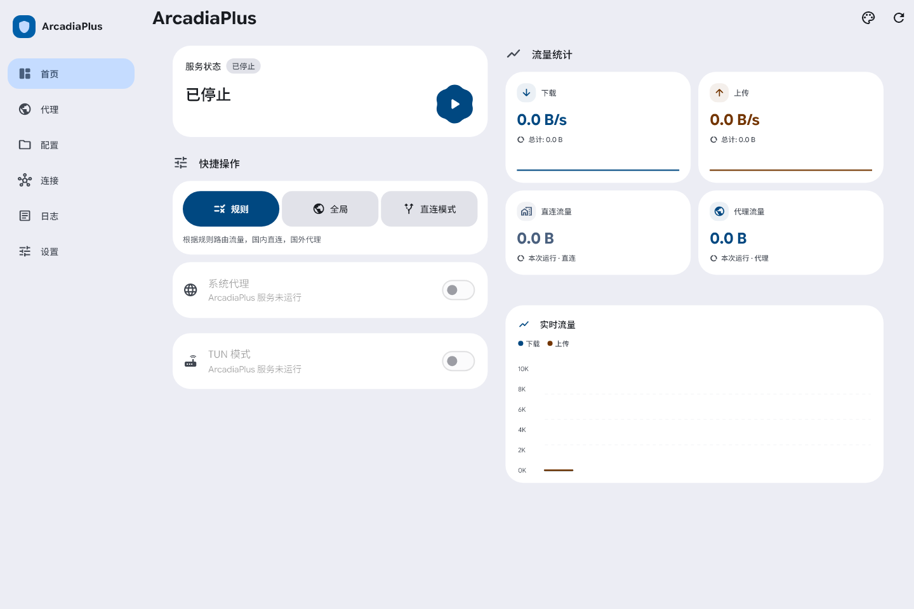
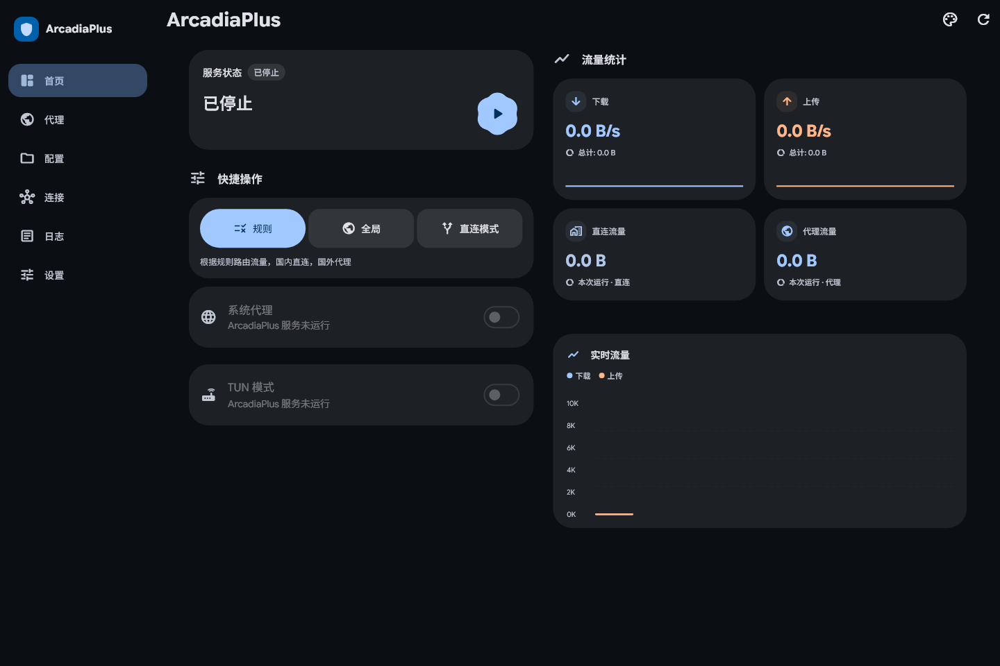
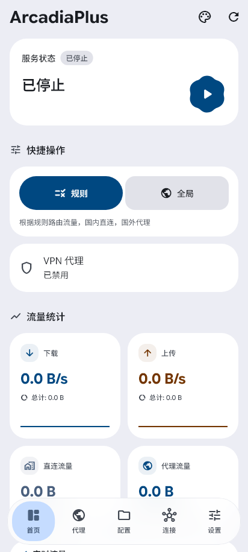
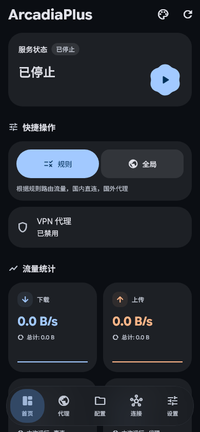
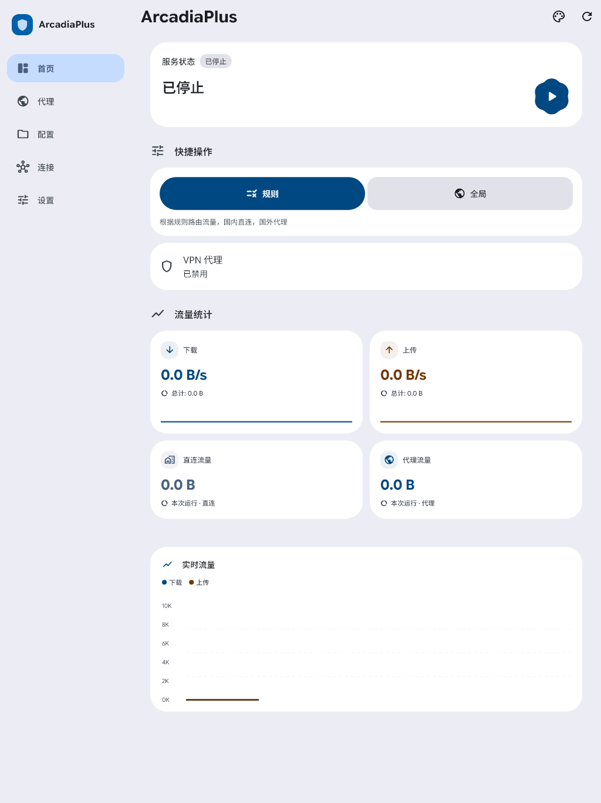

<p align="center">
  <picture>
    <source media="(prefers-color-scheme: dark)" srcset="assets/AcadiaPlusDark.jpg">
    
  </picture>
</p>

<h1 align="center">ArcadiaPlus</h1>
<p align="center">以 Flutter 构建界面，以 Rust 处理代理、分流与连接。</p>
<p align="center">
  <a href="README_EN.md">English</a> ·
  <a href="https://github.com/blueokanna/ArcadiaPlus/releases">下载</a> ·
  <a href="#界面预览">界面预览</a> ·
  <a href="#开发">开发</a> ·
  <a href="CONTRIBUTING.md">参与贡献</a>
</p>
<p align="center">
  <a href="https://github.com/blueokanna/ArcadiaPlus/actions/workflows/ci.yml"></a>
</p>

ArcadiaPlus 是面向桌面与移动设备的代理客户端，将配置管理、策略组选择、DNS 设置和连接诊断整合在同一套 Material 3 界面中。底层使用 Corduit 代理引擎，通过 Flutter Rust Bridge 与应用层通信，由各平台原生模块处理系统代理或 VPN 接入。

项目提供客户端与源码，不提供代理节点、订阅或服务器。Clash 形态配置需要转换为当前引擎支持的语义，不能视为 Mihomo 的完整替代实现。

## 功能

| 模块 | 能力 |
| --- | --- |
| 配置管理 | 导入订阅与本地配置，更新配置，管理节点与策略组 |
| 策略路由 | 规则、全局与直连模式；域名、IP、端口、进程及逻辑规则；支持的规则集加载 |
| DNS | Fake-IP 与真实地址模式、加密上游、域名策略，以及可选的 RecurseX 本地递归解析 |
| 连接诊断 | 连接详情、规则命中、DNS 活动、日志及直连／代理流量统计 |
| 界面 | 中英文、明暗主题、动态配色、自定义背景，以及手机、平板和桌面的响应式布局 |
| 系统集成 | Android VPN、Windows 系统代理与 Wintun、Linux 与 macOS 系统代理；具体限制见平台表 |

## 界面预览

以下图片于 **2026-11-15** 从当前源码的实际 Flutter 页面生成，覆盖两种语言与明暗主题。展示状态为服务停止、无配置、零流量，没有填充模拟测速或在线节点数据。图片是测试渲染器生成的布局预览，**不代表对应平台的真机运行或 VPN 验收**。生成方式与完整图集见[图片说明](docs/images/README.md)。

### 桌面布局

<picture>
  <source media="(prefers-color-scheme: dark)" srcset="docs/images/windows-zh-dark.png">
  
</picture>

<details>
<summary>macOS 与 Linux 目标布局</summary>

| macOS | Linux |
| --- | --- |
|  |  |

这些预览使用对应的 Flutter 目标平台设置；原生窗口、系统代理和隧道不在截图测试范围内。

</details>

### 手机与平板布局

| Android · 亮色 | iOS · 暗色 |
| --- | --- |
|  |  |

<details>
<summary>平板布局与 HarmonyOS NEXT 说明</summary>



平板图使用 Android 目标配置展示共享 Flutter 布局。HarmonyOS NEXT 使用独立 Flutter SDK 与原生扩展；这里不将共享布局标注为 HarmonyOS 真机截图。构建与验证要求见 [HarmonyOS NEXT 指南](ohos/README.md)。

</details>

## 平台支持

平台目录存在、构建成功和网络功能经过设备验证是不同的状态。下表说明当前实现范围；发行包以 Releases 对应版本的实际附件为准。

| 平台 | 当前实现 | 使用边界 |
| --- | --- | --- |
| Android | Flutter 界面、`VpnService` 与前台通知 | 需要 VPN 授权；ABI、后台存活和长连接仍需设备回归 |
| Windows | 系统代理、Wintun | TUN 需要管理员权限，需在目标 Windows 环境验证 |
| Linux | GNOME `gsettings` 系统代理、IPv4 TUN | TUN 当前仅接受全局模式，需要相应权限；其他桌面环境不保证自动配置 |
| macOS | `networksetup` 系统代理 | 尚无 Network Extension，不提供系统级全隧道 VPN |
| iOS | Flutter 应用界面 | 尚无 Packet Tunnel Extension，不作为可用 VPN 客户端发布承诺 |
| HarmonyOS NEXT | `VpnExtensionAbility` 与 Rust 数据面接入 | 使用专用工具链，仍需真机验证授权、隧道和分流 |

Android 通知已请求标准 Live Updates 提升。ColorOS 流体云的最终呈现由 ROM 与系统设置决定，尚不列为已验证的平台能力。

## 开始使用

1. 在 [Releases](https://github.com/blueokanna/ArcadiaPlus/releases) 选择适合系统与架构的发行包。
2. 导入已有订阅或本地配置，检查节点与策略组成员。
3. 选择路由模式，并按平台启用系统代理或 VPN/TUN。
4. 在连接详情中确认实际路由；需要诊断时保留脱敏日志与复现步骤。

系统代理只影响遵循系统代理设置的应用。规则模式也不意味着所有流量都经过远端代理：命中 DIRECT、代理组选择 DIRECT，或规则没有覆盖实际目标时，连接可以直连。

HLS 下载应分别检查播放列表与媒体分片域名。Fake-IP 有助于保留共享 CDN 地址背后的域名，但不能恢复应用自带 DoH 或缓存真实 IP 中隐藏的域名。相关边界与测试方法见[分流验证记录](docs/routing-and-android-validation.md)。

## 开发

主线工具链与 CI 保持一致：Flutter **3.47.2**、Dart **3.13**、Rust **1.97.0**；Android 使用 JDK **17** 与 NDK **28.2.13676358**。依赖版本以锁文件为准。HarmonyOS NEXT 请使用其独立构建指南。

```sh
git clone https://github.com/blueokanna/ArcadiaPlus.git
cd ArcadiaPlus
flutter pub get --enforce-lockfile
flutter analyze
flutter test
cargo test --manifest-path rust/Cargo.toml --locked
```

在对应宿主系统安装 Flutter 所需的原生工具链后构建：

| 目标 | 命令 |
| --- | --- |
| Android | `flutter build apk --release` |
| Windows | `flutter build windows --release` |
| macOS | `flutter build macos --release` |
| Linux | `flutter build linux --release` |

Android 发布前还应运行 `python scripts/check_android_page_sizes.py build/app/outputs/flutter-apk/app-release.apk`。签名、打包与依赖准备以[发行工作流](.github/workflows/release.yml)为准；本地构建成功不等于生成了可公开分发的签名产物。

### 代码导航

```text
lib/src/                     Flutter 页面、状态、配置转换与平台服务
packages/arcadia_expressive/  共享交互与动效组件
rust/src/                    引擎桥接、诊断与平台入口
rust/tests/                  Rust 集成测试
android/ · windows/ · linux/ · macos/ · ios/  原生宿主
ohos/                        HarmonyOS NEXT 宿主与 VPN 扩展
test/                        Dart 测试与文档图片渲染
scripts/                     构建检查、图标生成与设备验证
```

## 参与贡献

欢迎提交可复现的问题、范围明确的修复、设备验证结果与文档改进。当前值得推进的工作包括：分流与 DNS 边界回归、HLS/长连接验证、平台隧道集成、辅助功能与本地化。

涉及界面的改动应附更新后的预览；涉及网络的改动应说明命中规则、实际出口和验证环境。请勿在 Issue、日志或截图中提交订阅地址、密码、令牌与私有节点信息。

## 许可证与依赖

项目源码按 **PolyForm Perimeter License 1.0.1 及仓库附加条款**提供。授权范围、修改与分发条件以 [LICENSE](LICENSE) 为准；第三方字体、GeoIP 数据与 Wintun 等资源保留各自的许可。

核心依赖包括 Flutter、Rust、Flutter Rust Bridge、Corduit 与 RecurseX。具体版本与功能开关见 [pubspec.yaml](pubspec.yaml) 和 [rust/Cargo.toml](rust/Cargo.toml)。
