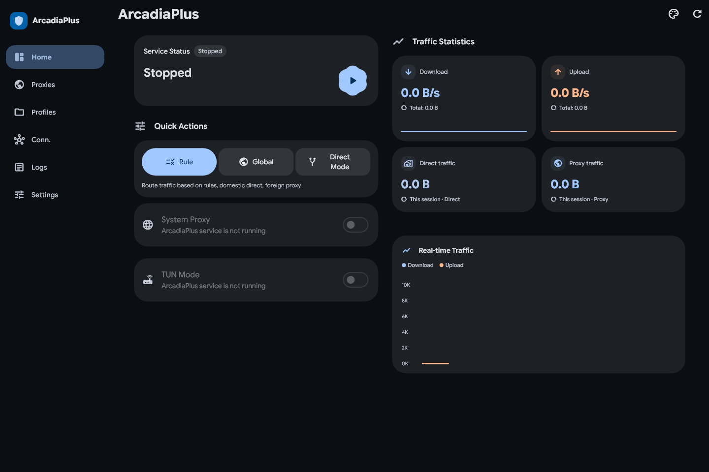
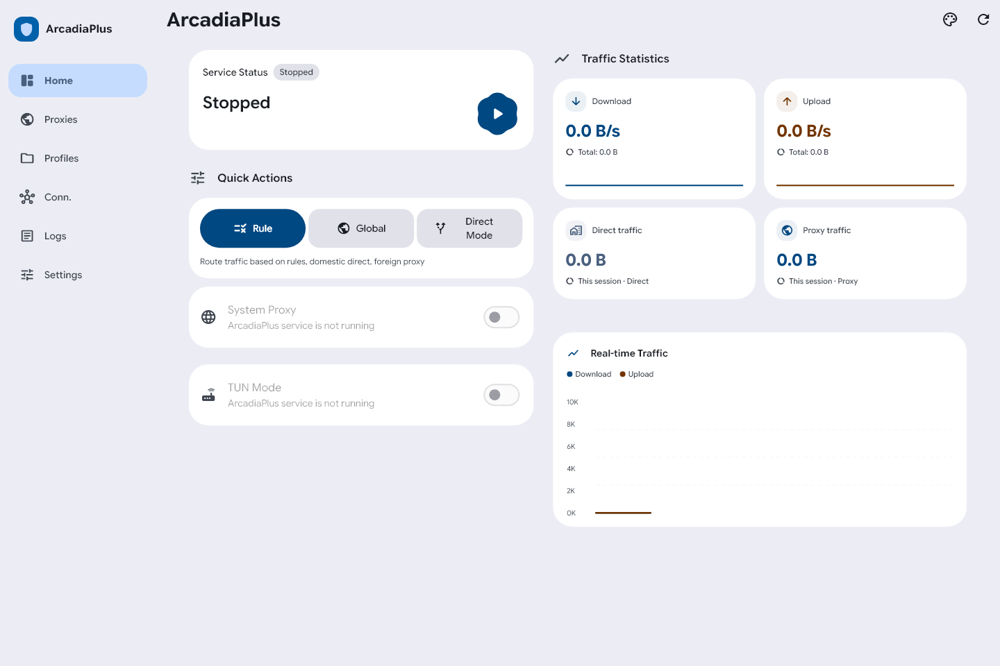
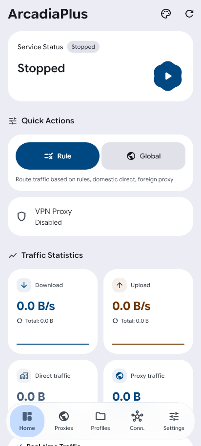
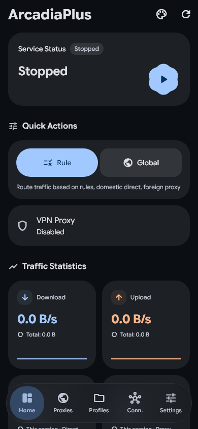
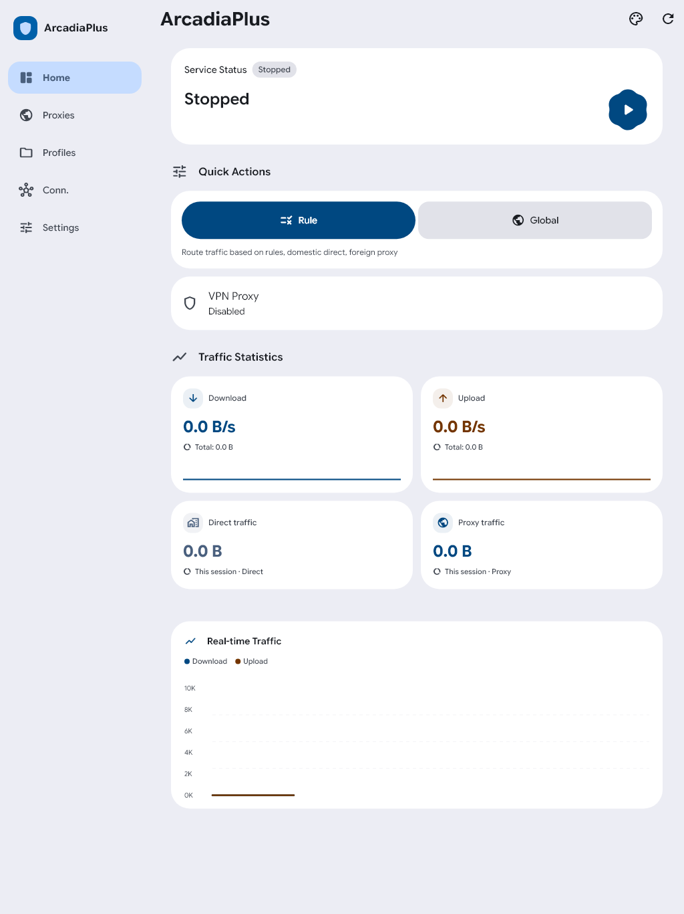

<p align="center">
  <picture>
    <source media="(prefers-color-scheme: dark)" srcset="assets/AcadiaPlusDark.jpg">
    
  </picture>
</p>

<h1 align="center">ArcadiaPlus</h1>
<p align="center">A Flutter interface for proxy routing and connections powered by Rust.</p>
<p align="center">
  <a href="README.md">中文</a> ·
  <a href="https://github.com/blueokanna/ArcadiaPlus/releases">Downloads</a> ·
  <a href="#interface-preview">Interface preview</a> ·
  <a href="#development">Development</a> ·
  <a href="CONTRIBUTING.md">Contributing</a>
</p>
<p align="center">
  <a href="https://github.com/blueokanna/ArcadiaPlus/actions/workflows/ci.yml"></a>
</p>

ArcadiaPlus is a proxy client for desktop and mobile devices. It brings profile management, policy groups, DNS configuration and connection diagnostics into one Material 3 interface. The Corduit engine communicates with the application through Flutter Rust Bridge; native modules handle system proxy and VPN integration.

The project provides a client and its source code, not proxy servers, nodes or subscriptions. Clash-style profiles are translated into the semantics supported by the current engine. ArcadiaPlus is not a complete replacement for Mihomo.

## Features

| Area | Capabilities |
| --- | --- |
| Profiles | Subscription and local configuration import, updates, nodes and policy groups |
| Routing | Rule, global and direct modes; domain, IP, port, process and logical rules; supported rule-set loading |
| DNS | Fake-IP and real-address modes, encrypted upstreams, domain policies and optional local recursion through RecurseX |
| Diagnostics | Connection details, rule hits, DNS activity, logs and separate direct/proxy traffic counters |
| Interface | English and Chinese, light and dark themes, dynamic colors, custom backgrounds and responsive layouts |
| Native integration | Android VPN, Windows system proxy and Wintun, Linux and macOS system proxy; limits are listed below |

## Interface preview

These images were rendered on **2026-11-15** from the actual Flutter pages in the current source tree, in both languages and both themes. They show an idle client with no profile and zero traffic, without fabricated speed tests or active nodes. They are **test-rendered layout previews, not native device screenshots or proof of VPN operation**. See [image provenance and regeneration](docs/images/README.md) for the full gallery.

### Desktop

<picture>
  <source media="(prefers-color-scheme: dark)" srcset="docs/images/windows-en-dark.png">
  
</picture>

<details>
<summary>macOS and Linux target layouts</summary>

| macOS | Linux |
| --- | --- |
|  |  |

These previews use the respective Flutter target-platform setting. Native windows, system proxy changes and tunnels are outside the capture test.

</details>

### Mobile and tablet

| Android · Light | iOS · Dark |
| --- | --- |
|  |  |

<details>
<summary>Tablet layout and HarmonyOS NEXT</summary>



The tablet preview uses an Android target configuration to render the shared Flutter layout. HarmonyOS NEXT requires a separate Flutter SDK and native extension; this layout is not presented as a HarmonyOS device screenshot. See the [HarmonyOS NEXT guide](ohos/README.md) for build and validation requirements.

</details>

## Platform support

A platform directory, a successful build and verified networking are separate milestones. This table describes the implementation in the repository. Available packages depend on the assets attached to each release.

| Platform | Implementation | Limits |
| --- | --- | --- |
| Android | Flutter UI, `VpnService` and foreground notifications | VPN authorization required; ABI, background operation and long connections need device regression tests |
| Windows | System proxy and Wintun | TUN requires elevation and validation on the target Windows environment |
| Linux | GNOME `gsettings` system proxy and IPv4 TUN | TUN currently accepts global mode only and requires privileges; automatic setup is not guaranteed on other desktops |
| macOS | System proxy through `networksetup` | No Network Extension; no system-wide full-tunnel VPN |
| iOS | Flutter application UI | No Packet Tunnel Extension; not represented as a working VPN client |
| HarmonyOS NEXT | `VpnExtensionAbility` and Rust data-path integration | Dedicated toolchain; authorization, tunnel and routing still require device validation |

Android notifications request standard Live Updates promotion. ColorOS Fluid Cloud presentation depends on the ROM and system settings and is not yet listed as a verified capability.

## Getting started

1. Download a package for your system and architecture from [Releases](https://github.com/blueokanna/ArcadiaPlus/releases).
2. Import an existing subscription or local profile and review its nodes and policy-group selections.
3. Select a routing mode, then enable the system proxy or VPN/TUN appropriate to your platform.
4. Confirm routing in connection details. Retain sanitized logs and reproduction steps when reporting a problem.

System proxy settings affect applications that honor them. Rule mode does not send every connection through a remote proxy: DIRECT rules, groups selecting DIRECT and rules that do not cover the actual destination can result in direct connections.

For HLS downloads, inspect both playlist and media-segment domains. Fake-IP helps retain domain identity behind shared CDN addresses; it cannot recover names hidden by an application's own DoH or cached real IPs. See the [routing validation notes](docs/routing-and-android-validation.md) for limitations and testing instructions.

## Development

The main toolchain follows CI: Flutter **3.47.2**, Dart **3.13** and Rust **1.97.0**. Android uses JDK **17** and NDK **28.2.13676358**. Lockfiles define dependency versions. HarmonyOS NEXT follows its separate build guide.

```sh
git clone https://github.com/blueokanna/ArcadiaPlus.git
cd ArcadiaPlus
flutter pub get --enforce-lockfile
flutter analyze
flutter test
cargo test --manifest-path rust/Cargo.toml --locked
```

Install Flutter's native build prerequisites on the appropriate host before building:

| Target | Command |
| --- | --- |
| Android | `flutter build apk --release` |
| Windows | `flutter build windows --release` |
| macOS | `flutter build macos --release` |
| Linux | `flutter build linux --release` |

Before distributing Android builds, also run `python scripts/check_android_page_sizes.py build/app/outputs/flutter-apk/app-release.apk`. The [release workflow](.github/workflows/release.yml) records signing, packaging and dependency setup. A successful local build is not necessarily a signed distribution artifact.

### Repository map

```text
lib/src/                     Flutter screens, state, configuration and services
packages/arcadia_expressive/  Shared interaction and motion components
rust/src/                    Engine bridge, diagnostics and platform entry points
rust/tests/                  Rust integration tests
android/ · windows/ · linux/ · macos/ · ios/  Native hosts
ohos/                        HarmonyOS NEXT host and VPN extension
test/                        Dart tests and documentation rendering
scripts/                     Build checks, icon generation and device validation
```

## Contributing

Contributions are welcome in the form of reproducible reports, focused fixes, device validation and documentation improvements. Useful areas include routing and DNS edge cases, HLS and long-connection verification, native tunnel integration, accessibility and localization.

Read the [contribution guide](CONTRIBUTING.md) before submitting code. Interface changes should include updated previews; networking changes should identify the matched rule, actual outbound and test environment. Do not include subscription URLs, passwords, tokens or private node information in issues, logs or images.

## License and dependencies

Source code is provided under **PolyForm Perimeter License 1.0.1 with repository-specific additional terms**. [LICENSE](LICENSE) defines the permissions and conditions for modification and distribution. Third-party fonts, GeoIP data, Wintun and other bundled resources retain their own licenses.

Core dependencies include Flutter, Rust, Flutter Rust Bridge, Corduit and RecurseX. See [pubspec.yaml](pubspec.yaml) and [rust/Cargo.toml](rust/Cargo.toml) for versions and enabled features.
